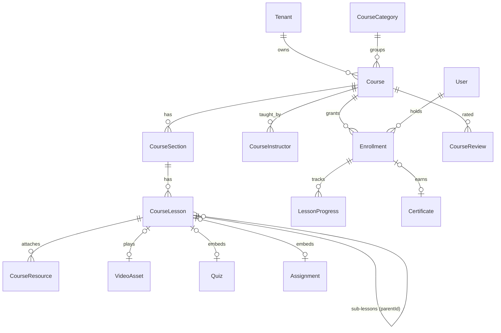

# Database ERD (MySQL 8.4, Prisma)

Status: **Phase 0 design**. The Prisma schema will be generated from this document in Phase 1–2 and evolved per phase via migrations.

## 1. Global conventions

| Rule | Implementation |
|---|---|
| Primary key | `id CHAR(25)` CUID (`String @id @default(cuid()) @db.Char(25)`) |
| Tenant ownership | `tenantId CHAR(25) NOT NULL` + `@@unique([tenantId, id])` on every tenant-owned table |
| Tenant-aware FKs | Child → parent relations use `(tenantId, parentId) → (tenantId, id)` so a row can never reference another tenant's parent |
| Timestamps | `createdAt DATETIME(3)`, `updatedAt DATETIME(3)` — always UTC (Prisma + `timezone=Z` on connection) |
| Soft delete | `deletedAt DATETIME(3) NULL` on user-facing content (courses, products, pages, posts, users, tenants). Financial tables are **never** soft- or hard-deleted |
| Money | `DECIMAL(19,4)` + `currency CHAR(3)` (ISO-4217) on the same row |
| Enums | Prisma enums (MySQL `ENUM`) for closed state machines; `VARCHAR` keys for open sets (feature keys, permission keys) |
| JSON | `JSON` only for genuinely schemaless data (page blocks, provider payloads, settings blobs) |
| Secrets | Integration credentials encrypted (AES-256-GCM, key from env/KMS) in `*_encrypted` columns; never returned by APIs |
| Indexes | Every list query has a leading `tenantId` composite index, e.g. `(tenantId, status, createdAt)` |
| Charset | `utf8mb4` / `utf8mb4_0900_ai_ci` |

Legend below: **PK** primary key, **T** tenant-owned (has `tenantId`), `→` FK, `U()` unique, `I()` index.

---

## 2. Identity & access

| Model | T | Key columns | Constraints / notes |
|---|---|---|---|
| **User** | opt | realm (`PLATFORM`/`TENANT`), realmKey (`'platform'` or tenantId), tenantId?, email, emailVerifiedAt, phone, phoneVerifiedAt, passwordHash (argon2id), fullName, avatarFileId, country, locale, timezone, status (`ACTIVE/SUSPENDED/PENDING`), twoFactorSecretEnc, twoFactorEnabled, lastLoginAt, failedLoginCount, lockedUntil, deletedAt | U(realmKey,email), U(realmKey,phone), I(tenantId,status) |
| **OAuthAccount** | – | userId→User, provider, providerAccountId | U(provider,providerAccountId,userId) |
| **Role** | opt | tenantId? (null = system role), key, name, scope (`PLATFORM`/`TENANT`), isSystem | U(tenantId,key) |
| **Permission** | – | key (`courses.update`), group, description | U(key) — seeded from `packages/shared` |
| **RolePermission** | – | roleId, permissionId | PK(roleId,permissionId) |
| **UserRole** | opt | userId, roleId, tenantId? | U(userId,roleId,tenantId) — platform roles (SUPER_ADMIN, PLATFORM_ADMIN, FINANCE_ADMIN, SUPPORT_ADMIN) |
| **TenantMember** | T | userId→User(platform), roleId→Role, status, invitedById, invitedAt, joinedAt | U(tenantId,userId) — creators & staff |
| **StaffInvitation** | T | email, roleId, tokenHash, expiresAt, acceptedAt | I(tenantId,email) |
| **UserSession** | opt | userId, refreshTokenHash, familyId, rotatedFromId, userAgent, ip, deviceLabel, lastUsedAt, expiresAt, revokedAt, revokeReason | I(userId,revokedAt), U(refreshTokenHash) |
| **LoginHistory** | opt | userId?, emailTried, success, failureReason, ip, userAgent | I(userId,createdAt), I(ip,createdAt) |
| **PasswordReset** | – | userId, tokenHash, expiresAt, usedAt | U(tokenHash) |
| **EmailVerification** | – | userId, tokenHash, expiresAt, usedAt | U(tokenHash) |
| **OtpCode** | – | target (email/phone), purpose, codeHash, attempts, expiresAt, consumedAt | I(target,purpose) |

## 3. SaaS core

| Model | T | Key columns | Notes |
|---|---|---|---|
| **Tenant** | (root) | slug, name, ownerUserId→User, status (`ONBOARDING/ACTIVE/SUSPENDED/PENDING_DELETION/DELETED`), category, country, defaultCurrency, timezone, locale, onboardingStep, onboardingCompletedAt, suspendedReason, deletedAt | U(slug) |
| **TenantSetting** | T | key, value JSON | U(tenantId,key) |
| **TenantBusinessProfile** | T | legalName, address JSON, gstin, pan, taxId, invoicePrefix | U(tenantId) |
| **TenantDomain** | T | hostname, type (`SUBDOMAIN/CUSTOM`), isPrimary, verificationToken, verifiedAt, dnsStatus, sslStatus (`PENDING/ISSUED/FAILED/EXPIRED`), sslExpiresAt | U(hostname) |
| **TenantLimitOverride** | T | featureKey, limitValue, reason, setById | U(tenantId,featureKey) |
| **SubscriptionPlan** | – | code, name, description, status (`DRAFT/ACTIVE/ARCHIVED`), isPublic, trialDays, sortOrder | U(code) |
| **PlanPrice** | – | planId, interval (`MONTH/YEAR`), currency, amount, providerPriceIds JSON | U(planId,interval,currency) |
| **PlanFeature** | – | planId, featureKey, enabled, limitValue (BIGINT, null = unlimited), meta JSON | U(planId,featureKey). Keys: `courses.max`, `students.max`, `staff.max`, `storage.gb`, `bandwidth.gb`, `domains.custom`, `website_builder`, `marketing`, `affiliates`, `live_classes`, `analytics.advanced`, `ai.credits`, `white_label`, `commission.percent` … |
| **Subscription** | T | planId, planPriceId, status (`TRIALING/ACTIVE/PAST_DUE/GRACE/CANCELED/EXPIRED`), currentPeriodStart, currentPeriodEnd, trialEndsAt, cancelAtPeriodEnd, canceledAt, graceEndsAt, provider, providerSubscriptionId, featureSnapshot JSON | I(tenantId,status); one non-terminal subscription per tenant enforced in service + `activeKey` unique column |
| **SubscriptionChange** | T | subscriptionId, fromPlanId, toPlanId, type (`UPGRADE/DOWNGRADE/RENEW/CANCEL`), effectiveAt, prorationAmount | history |
| **SubscriptionInvoice** | T | subscriptionId, number, status, subtotal, tax, total, currency, periodStart, periodEnd, paidAt, pdfFileId | U(number) |
| **UsageRecord** | T | metric (`storage.bytes`, `bandwidth.bytes`, `ai.credits`, `students.count`…), periodStart, quantity | U(tenantId,metric,periodStart) |
| **UsageEvent** | T | metric, delta, sourceType, sourceId | raw events rolled up into UsageRecord |

## 4. Academy & website

| Model | T | Key columns |
|---|---|---|
| **Academy** | T | name, tagline, description, logoFileId, faviconFileId, supportEmail, socialLinks JSON, status (`DRAFT/PUBLISHED`), publishedAt — U(tenantId) |
| **AcademyTheme** | T | primaryColor, secondaryColor, fontHeading, fontBody, radius, mode, tokens JSON |
| **AcademySetting** | T | key, value JSON — U(tenantId,key) |
| **AcademyNavigation** | T | location (`HEADER/FOOTER`), items JSON (validated: label, pageId/url) |
| **AcademyPage** | T | slug, title, type (`HOME/ABOUT/CONTACT/FAQ/POLICY/CUSTOM/LANDING`), status, publishedVersionId, draftVersionId, seoTitle, seoDescription, ogImageFileId, locale, deletedAt — U(tenantId,slug,locale) |
| **AcademyPageVersion** | T | pageId, version, blocks JSON (schema-validated block tree, no raw HTML), createdById, note — U(tenantId,pageId,version) |
| **WebsiteTemplate** | – | key, name, previewFileId, pages JSON |
| **BlogPost** | T | slug, title, excerpt, content JSON (TipTap, sanitized), coverFileId, authorId, status, publishedAt — U(tenantId,slug) |
| **ContactSubmission** | T | name, email, phone, message, source, handledAt |

## 5. LMS

| Model | T | Key columns / constraints |
|---|---|---|
| **CourseCategory** | opt | tenantId? (null = platform category), name, slug, parentId — U(tenantId,slug) |
| **Course** | T | title, slug, shortDescription, description JSON, thumbnailFileId, bannerFileId, categoryId, tags JSON, language, level, objectives JSON, prerequisites JSON, durationMinutes, status (`DRAFT/SCHEDULED/PUBLISHED/UNPUBLISHED/ARCHIVED`), visibility (`PUBLIC/UNLISTED/PRIVATE`), publishAt, accessType (`LIFETIME/FIXED_DAYS/FIXED_DATE`), accessDays, accessUntil, dripType (`NONE/DAYS_AFTER_ENROLL/DATE`), completionRule JSON, certificateTemplateId?, certificateEnabled, seoTitle, seoDescription, deletedAt — U(tenantId,slug), I(tenantId,status) |
| **CourseInstructor** | T | courseId, userId (TenantMember user), isPrimary — U(tenantId,courseId,userId) |
| **CourseSection** | T | courseId, title, position, dripOffsetDays, unlockAt — I(tenantId,courseId,position) |
| **CourseLesson** | T | courseId, sectionId, parentLessonId?, title, type (`VIDEO/AUDIO/PDF/DOCUMENT/TEXT/IMAGE/LINK/QUIZ/ASSIGNMENT/LIVE/DOWNLOAD`), position, content JSON, videoAssetId?, fileAssetId?, quizId?, assignmentId?, liveClassSessionId?, externalUrl, isFreePreview, isPublished, dripOffsetDays, unlockAt, durationSeconds, isRequired |
| **CourseResource** | T | courseId, lessonId?, fileAssetId, title, downloadable |
| **CoursePrerequisite** | T | courseId, requiredCourseId — U(tenantId,courseId,requiredCourseId) |
| **Enrollment** | T | userId (tenant user), courseId, source (`PURCHASE/MANUAL/MEMBERSHIP/BUNDLE/FREE/BATCH/IMPORT`), orderItemId?, membershipSubscriptionId?, batchId?, status (`ACTIVE/EXPIRED/REVOKED/COMPLETED`), startedAt, expiresAt, completedAt, progressPercent, lastLessonId, lastAccessedAt — U(tenantId,userId,courseId), I(tenantId,courseId,status) |
| **LessonProgress** | T | enrollmentId, lessonId, userId, status, watchedSeconds, lastPositionSeconds, completedAt — U(tenantId,enrollmentId,lessonId) |
| **CourseReview** | T | courseId, userId, rating TINYINT, body, status (`PENDING/APPROVED/HIDDEN`) — U(tenantId,courseId,userId) |
| **CourseBookmark** | T | userId, lessonId — U(tenantId,userId,lessonId) |
| **LessonNote** | T | userId, lessonId, body, positionSeconds |
| **LessonDiscussion** / **LessonDiscussionReply** | T | lessonId, userId, body, isResolved, parentId |

## 6. Video, DRM & files

| Model | T | Key columns |
|---|---|---|
| **FileAsset** | opt | tenantId?, ownerUserId, bucket, key, mimeType, sizeBytes, checksum, visibility (`PRIVATE/PUBLIC_CDN`), purpose (`VIDEO_SOURCE/PDF/IMAGE/SUBMISSION/INVOICE/CERTIFICATE/…`), status (`UPLOADING/READY/REJECTED/DELETED`), uploadId (multipart) — U(bucket,key) |
| **VideoProvider** | opt | tenantId? (null = platform default), type (`VDOCIPHER/MUX/AWS_MEDIACONVERT`), name, configEnc, status (`NOT_CONFIGURED/CONFIGURED/VERIFIED/ERROR`), drmCapable, lastVerifiedAt |
| **VideoAsset** | T | title, sourceFileId, providerId, providerAssetId, status (`UPLOADING/UPLOADED/PROCESSING/READY/FAILED`), durationSeconds, renditions JSON, thumbnailFileId, drmEnabled, protection (`NONE/SIGNED/AES128/DRM`), errorMessage |
| **VideoSubtitle** / **VideoAudioTrack** | T | videoAssetId, language, label, fileAssetId, providerTrackId |
| **VideoProcessingJob** | T | videoAssetId, step, status, attempts, providerJobId, error, startedAt, finishedAt |
| **VideoPlaybackSession** | T | videoAssetId, userId, enrollmentId, tokenId (jti), ip, userAgent, deviceFingerprintHash, expiresAt, revokedAt — I(tenantId,userId,createdAt) |
| **VideoAccessLog** | T | playbackSessionId, event (`ISSUED/LICENSE/HEARTBEAT/DENIED`), reason, ip |
| **WatermarkSetting** | T | scope (`TENANT/COURSE`), courseId?, enabled, fields JSON (name, maskedEmail, studentId, timestamp), position (`RANDOM/TL/TR/BL/BR`), opacity, fontSize, moveIntervalSec |
| **PdfAccessLog** | T | fileAssetId, userId, action (`VIEW/DOWNLOAD`), watermarked |
| **PlaybackDevice** | T | userId, fingerprintHash, label, lastSeenAt — limit per course config |

## 7. Assessment

| Model | T | Key columns |
|---|---|---|
| **QuestionBank** | T | name, courseId? |
| **Quiz** | T | courseId?, title, instructions, timeLimitSec, passPercent, negativeMarkRatio, maxAttempts, shuffleQuestions, shuffleOptions, randomPickCount, showResults (`IMMEDIATE/AFTER_DUE/NEVER`), status |
| **QuizQuestion** | T | quizId? / bankId?, type (`MCQ_SINGLE/MCQ_MULTI/TRUE_FALSE/FILL_BLANK/SHORT/LONG/MATCHING/FILE_UPLOAD`), prompt JSON, points, explanation, position, meta JSON (blanks, matching pairs) |
| **QuizOption** | T | questionId, label, isCorrect, matchKey, position |
| **QuizAttempt** | T | quizId, userId, enrollmentId, attemptNo, startedAt, submittedAt, expiresAt, score, maxScore, percent, passed, status (`IN_PROGRESS/SUBMITTED/GRADING/GRADED`), questionOrder JSON — U(tenantId,quizId,userId,attemptNo) |
| **QuizAnswer** | T | attemptId, questionId, response JSON, fileAssetId?, isCorrect, pointsAwarded, gradedById, feedback |
| **Assignment** | T | courseId?, batchId?, title, instructions JSON, dueAt, maxPoints, allowLate, allowedFileTypes JSON |
| **AssignmentSubmission** | T | assignmentId, userId, text JSON, fileAssetIds JSON, submittedAt, status (`SUBMITTED/RETURNED/GRADED`), points, feedback, gradedById, gradedAt — I(tenantId,assignmentId,status) |

## 8. Commerce & finance

| Model | T | Key columns / notes |
|---|---|---|
| **Product** | T | type (`COURSE/LIVE_COURSE/BUNDLE/DIGITAL_DOWNLOAD/MEMBERSHIP/COACHING/COHORT/WEBINAR`), title, slug, description JSON, status, visibility, thumbnailFileId, taxCategory, deletedAt — U(tenantId,slug) |
| **ProductItem** | T | productId, itemType, courseId? / fileAssetId? / membershipPlanId? / batchId? / webinarId? — what a purchase grants |
| **ProductPrice** | T | productId, type (`ONE_TIME/RECURRING/INSTALLMENT`), currency, amount, compareAtAmount, interval, intervalCount, isDefault, active |
| **Cart** / **CartItem** | T | userId? / anonymousKey, currency, status; CartItem: productId, priceId, quantity |
| **CheckoutSession** | T | cartId?, userId?, email, items snapshot JSON, couponCode, affiliateRef, totals, status (`OPEN/COMPLETED/ABANDONED/EXPIRED`), abandonedNotifiedAt |
| **Order** | T | number, userId, status (`PENDING/PAYMENT_INITIATED/PAID/FAILED/CANCELLED/PARTIALLY_REFUNDED/REFUNDED`), currency, subtotal, discountTotal, taxTotal, total, couponId?, affiliateId?, billingAddress JSON, taxBreakdown JSON, paidAt, idempotencyKey — U(tenantId,number), U(tenantId,idempotencyKey) |
| **OrderItem** | T | orderId, productId, priceId, titleSnapshot, unitAmount, quantity, discount, tax, total |
| **OrderStatusHistory** | T | orderId, from, to, reason, actor |
| **PaymentGatewayAccount** | opt | tenantId? (null = platform merchant), provider (`RAZORPAY/CASHFREE/STRIPE/PAYPAL`), mode (`CREATOR_OWNED/PLATFORM_MANAGED`), credentialsEnc, webhookSecretEnc, status, isLive |
| **Payment** | T | orderId? / subscriptionInvoiceId?, gatewayAccountId, provider, providerOrderId, providerPaymentId, method (`UPI/CARD/NETBANKING/WALLET/PAYPAL`), status (`CREATED/AUTHORIZED/CAPTURED/FAILED/REFUNDED/PARTIALLY_REFUNDED`), amount, currency, fee, tax, failureCode, rawSummary JSON — U(provider,providerPaymentId) |
| **Refund** | T | paymentId, orderId, amount, reason, status (`REQUESTED/APPROVED/PROCESSING/SUCCEEDED/FAILED/REJECTED`), providerRefundId, requestedById, approvedById |
| **Coupon** | T | code, type (`PERCENT/FIXED`), value, currency?, maxRedemptions, perUserLimit, startsAt, endsAt, minOrderAmount, appliesTo JSON (product ids), affiliateId?, status — U(tenantId,code) |
| **CouponRedemption** | T | couponId, orderId, userId, discountAmount — U(tenantId,couponId,orderId) |
| **Invoice** | T | orderId, number, sellerSnapshot JSON, buyerSnapshot JSON, lines JSON, taxBreakdown JSON, total, currency, pdfFileId — U(tenantId,number) |
| **TaxRule** | opt | tenantId?, jurisdiction (country/state), name, ratePercent, inclusive, category |
| **LedgerAccount** | opt | tenantId?, type (`PLATFORM_REVENUE/PLATFORM_COMMISSION/CREATOR_PAYABLE/AFFILIATE_PAYABLE/GATEWAY_FEES/TAX_PAYABLE/REFUNDS`), currency — U(tenantId,type,currency) |
| **LedgerTransaction** | opt | tenantId?, type, referenceType, referenceId, occurredAt, description |
| **LedgerEntry** | opt | transactionId, accountId, direction (`DEBIT/CREDIT`), amount, currency — sum(debits)=sum(credits) per transaction enforced in service inside a DB transaction; append-only |
| **Settlement** | T | provider, providerSettlementId, periodStart, periodEnd, grossAmount, fees, netAmount, currency, status, reconciledAt |
| **CreatorPayout** | T | amount, currency, status, method, reference, periodStart, periodEnd, approvedById |
| **WebhookEvent** | opt | provider, eventId, eventType, signatureValid, payload JSON, status (`RECEIVED/PROCESSED/FAILED/IGNORED`), attempts, processedAt, error — U(provider,eventId) for idempotency |

## 9. Live learning & cohorts

| Model | T | Key columns |
|---|---|---|
| **LiveProviderAccount** | opt | tenantId?, provider (`LIVEKIT/ZOOM/GOOGLE_MEET`), credentialsEnc, status |
| **LiveClass** | T | title, description, courseId?, batchId?, provider, capacity, waitingRoom, recordingEnabled, recurrenceRule (RRULE), timezone, status |
| **LiveClassSession** | T | liveClassId, startsAt, endsAt, status (`SCHEDULED/LIVE/ENDED/CANCELLED`), providerRoomId, joinUrl (host-only), startedAt, endedAt |
| **LiveClassInstructor** | T | liveClassId, userId, role (`HOST/CO_HOST`) |
| **LiveClassEnrollment** | T | liveClassId, userId, source — U(tenantId,liveClassId,userId) |
| **LiveClassAttendance** | T | sessionId, userId, joinedAt, leftAt, durationSeconds, percent — I(tenantId,sessionId,userId) (multiple join/leave intervals) |
| **LiveClassRecording** | T | sessionId, providerRecordingId, videoAssetId?, status, durationSeconds |
| **LiveClassChat** | T | sessionId, userId, kind (`CHAT/QUESTION/ANSWER`), body, parentId, isPinned |
| **LiveClassPoll** / **LivePollOption** / **LivePollVote** | T | sessionId, question, options, votes — U(pollId,userId) |
| **LiveClassMaterial** | T | liveClassId, fileAssetId |
| **Webinar** | T | productId?, title, isPaid, startsAt, capacity, liveClassId, registrationFields JSON, status |
| **WebinarRegistration** | T | webinarId, userId?, email, name, ticketCode, orderId?, attendedAt — U(tenantId,webinarId,email) |
| **Batch** | T | name, courseId?, startDate, endDate, capacity, status |
| **BatchInstructor** / **BatchMember** | T | batchId, userId — unique per batch |
| **BatchAnnouncement** / **BatchDiscussion** | T | batchId, authorId, body |

## 10. Marketing & affiliates

| Model | T | Key columns |
|---|---|---|
| **Lead** | T | email, phone, name, source, utm JSON, tags JSON, status, userId? — U(tenantId,email) |
| **MarketingConsent** | T | userId?/leadId?, channel (`EMAIL/SMS/WHATSAPP`), status (`OPTED_IN/OPTED_OUT`), source, changedAt — U(tenantId,channel,contactKey) |
| **Segment** | T | name, rules JSON (validated DSL) |
| **EmailTemplate** | opt | tenantId? (null = platform), key, name, channel, subject, bodyJson, bodyHtmlCompiled, variables JSON, locale |
| **Campaign** | T | name, channel, templateId, segmentId, status (`DRAFT/SCHEDULED/SENDING/SENT/CANCELLED`), scheduledAt, stats JSON |
| **CampaignRecipient** | T | campaignId, contactKey, status, sentAt, openedAt, clickedAt, error — U(campaignId,contactKey) |
| **MarketingAutomation** | T | name, trigger (`USER_REGISTERED/ORDER_PAID/CHECKOUT_ABANDONED/INACTIVE_DAYS/COURSE_COMPLETED`), triggerConfig JSON, status |
| **AutomationStep** | T | automationId, position, type (`WAIT/SEND_EMAIL/SEND_SMS/SEND_WHATSAPP/CONDITION`), config JSON |
| **AutomationRun** | T | automationId, contactKey, currentStep, status, nextRunAt |
| **MarketingEvent** | T | type, contactKey, campaignId?, automationId?, meta JSON — analytics stream |
| **Affiliate** | T | userId (tenant realm), status (`PENDING/APPROVED/REJECTED/SUSPENDED`), defaultCommissionType, defaultCommissionValue, payoutDetailsEnc |
| **AffiliateCommissionRule** | T | affiliateId?, productId?, type (`PERCENT/FIXED`), value — most specific wins |
| **AffiliateLink** | T | affiliateId, code, productId?, destination — U(tenantId,code) |
| **AffiliateClick** | T | linkId, ipHash, userAgent, referrer, visitorId, createdAt — I(tenantId,linkId,createdAt) |
| **AffiliateConversion** | T | affiliateId, orderId, clickId?, couponId?, attributionType (`LINK/COUPON`), status — U(tenantId,orderId) |
| **AffiliateCommission** | T | conversionId, amount, currency, status (`PENDING/APPROVED/REVERSED/PAID`), availableAt (after refund window), reversedReason |
| **AffiliatePayout** | T | affiliateId, amount, currency, status (`REQUESTED/APPROVED/PAID/REJECTED`), reference |

## 11. Community & memberships

| Model | T | Key columns |
|---|---|---|
| **Community** | T | name, slug, visibility (`PUBLIC/PRIVATE`), courseId?, membershipPlanId?, status |
| **CommunityMember** | T | communityId, userId, role (`MEMBER/MODERATOR/ADMIN`), status (`ACTIVE/MUTED/BANNED`) — U(tenantId,communityId,userId) |
| **CommunityPost** | T | communityId, authorId, type (`POST/ANNOUNCEMENT/THREAD`), title, body JSON, isPinned, status (`PUBLISHED/HIDDEN/REMOVED`) |
| **CommunityComment** | T | postId, authorId, parentId, body |
| **CommunityReaction** | T | targetType, targetId, userId, type — U(tenantId,targetType,targetId,userId,type) |
| **CommunityReport** | T | targetType, targetId, reporterId, reason, resolvedAt |
| **MembershipPlan** | T | productId, name, tier, accessRules JSON (courses, communities, content) |
| **MembershipSubscription** | T | membershipPlanId, userId, status (`ACTIVE/PAST_DUE/CANCELED/EXPIRED`), currentPeriodEnd, provider, providerSubscriptionId, cancelAtPeriodEnd |

## 12. Certificates

| Model | T | Key columns |
|---|---|---|
| **CertificateTemplate** | T | name, layout JSON (positions of variables), backgroundFileId, orientation, status |
| **Certificate** | T | number (globally unique, non-guessable, e.g. `CE-2026-7F3K9Q2M`), templateId, userId, courseId, enrollmentId, recipientName, courseTitle, issuedAt, pdfFileId, status (`ISSUED/REVOKED`), revokedAt, revokedReason — U(number), U(tenantId,enrollmentId) |
| **CertificateVerification** | T | certificateId, ipHash, userAgent, verifiedAt |

## 13. AI

| Model | T | Key columns |
|---|---|---|
| **AiProviderConfig** | opt | tenantId?, provider (`ANTHROPIC/OPENAI`), model, credentialsEnc, status |
| **AiCreditLedger** | T | delta, balanceAfter, reason, referenceType, referenceId |
| **AiRequest** | T | feature (`COURSE_OUTLINE/QUIZ_GEN/STUDENT_ASSISTANT/MARKETING_COPY…`), userId, inputTokens, outputTokens, creditsCharged, status, latencyMs |
| **AiDocumentChunk** | T | sourceType (lesson/resource), sourceId, courseId, chunkIndex, text, embedding JSON/VECTOR, model |
| **AiConversation** / **AiMessage** | T | userId, courseId?, role, content |

## 14. Operations

| Model | T | Key columns |
|---|---|---|
| **Notification** | opt | tenantId?, userId, type, title, body, link, readAt, channel status JSON — I(userId,readAt,createdAt) |
| **NotificationTemplate** | opt | tenantId? (override), event, channel, locale, subject, body, isActive — U(tenantId,event,channel,locale) |
| **NotificationPreference** | opt | userId, event, channel, enabled |
| **WebPushSubscription** | opt | userId, endpoint, keys JSON |
| **SupportTicket** | opt | tenantId? (creator tickets → platform; student tickets → creator), requesterId, assigneeId, category, priority (`LOW/MEDIUM/HIGH/URGENT`), status (`OPEN/PENDING/ON_HOLD/RESOLVED/CLOSED`), subject, firstResponseAt, resolvedAt, slaDueAt |
| **SupportMessage** | opt | ticketId, authorId, body, isInternalNote, attachmentFileIds JSON |
| **AuditLog** | opt | tenantId?, actorUserId, actorRealm, action (`tenant.suspend`), targetType, targetId, before JSON, after JSON (redacted), ip, userAgent, requestId — append-only, I(tenantId,createdAt), I(action,createdAt) |
| **PlatformSetting** | – | key, value JSON, isSecret (value encrypted) — U(key) |
| **Announcement** | opt | audience (`CREATORS/STUDENTS/ALL`), title, body, startsAt, endsAt |
| **ExportJob** | opt | tenantId?, requestedById, type, filters JSON, status, fileAssetId, expiresAt |
| **AnalyticsDailySnapshot** | opt | tenantId?, date, metric, dimension, value — U(tenantId,date,metric,dimension) |
| **IdempotencyKey** | opt | scope, key, responseHash, expiresAt — U(scope,key) |

## 15. Critical integrity rules

1. **Order → Enrollment** happens only inside the `payment.captured` webhook processor, in one DB transaction: order `PAID` + payment `CAPTURED` + enrollments + coupon redemption + ledger entries + affiliate conversion. Re-delivery is a no-op (`WebhookEvent` unique + status checks).
2. Refund: ledger reversal, enrollment revoke (configurable), commission reversal, order state → `PARTIALLY_REFUNDED`/`REFUNDED` — single transaction after provider confirms.
3. Tenant hard delete: only after retention period; financial rows retained (tenant row kept as `DELETED` tombstone, PII anonymised).
4. All counters used for limits (students, courses, storage) are computed from source tables or `UsageRecord`, checked inside the same transaction as the create (`SELECT … FOR UPDATE` on the tenant usage row).
